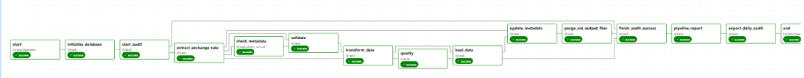
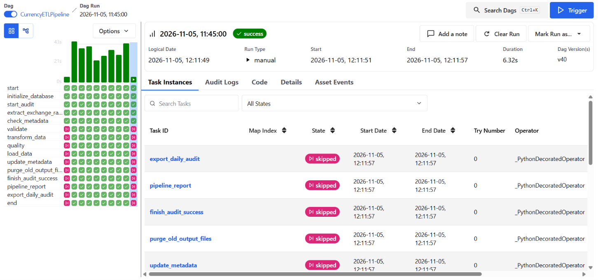

# Currency Exchange Rate ETL Pipeline using Apache Airflow
[](https://github.com/SujitaRijal/CurrencyETLPipeline/actions/workflows/ci.yml)


A production-style ETL pipeline built using **Apache Airflow 3, Python, PostgreSQL, Docker, and REST API integration** to automate the extraction, validation, transformation, and loading of daily currency exchange rate data.

The project demonstrates production-oriented data engineering practices including **incremental data processing, idempotent database loading, execution auditing, failure handling, automated notifications, testing, and CI automation using GitHub Actions.**

---

# Project Overview

This project implements an end-to-end ETL workflow that extracts currency exchange rates from the **Exchange Rate API (`open.er-api.com`)**, validates and transforms the API response, performs data quality checks, and loads processed exchange rate records into PostgreSQL.

The pipeline is orchestrated using **Apache Airflow TaskFlow API** and follows a modular architecture by separating extraction, validation, transformation, quality checks, loading, metadata management, auditing, callbacks, and utility components.

The project focuses on real-world data engineering practices:

- Incremental loading using metadata tracking
- Idempotent database operations
- Pipeline execution auditing
- Failure callbacks and email notifications
- Automated file retention
- Docker-based environment setup
- Automated testing and CI validation

---

# Features

## Automated ETL Pipeline

- Extracts daily exchange rate data from an external REST API.
- Stores raw API responses for traceability.
- Processes data through validation, transformation, and loading stages.

## Incremental Loading

- Tracks previously processed API timestamps using an ETL metadata table.
- Skips unnecessary processing when no new data is available.
- Uses Airflow `@task.short_circuit` for conditional execution.

## Data Validation & Quality Checks

- Validates API response structure and required fields.
- Removes invalid exchange rate records.
- Performs quality checks before loading data into PostgreSQL.

## Idempotent Database Loading

- Prevents duplicate records using PostgreSQL unique constraints.
- Uses `ON CONFLICT DO NOTHING` during insertion.

## Execution Auditing

Tracks pipeline execution details including:

- Pipeline status:
  - RUNNING
  - SUCCESS
  - SKIPPED
  - FAILED
- Execution timestamps
- Loaded records
- Error messages

## Failure Handling & Notifications

- Uses Airflow callbacks for failure management.
- Updates audit records automatically.
- Sends email notifications through SMTP configuration.

## File Management

- Stores raw and processed JSON files.
- Automatically removes expired files based on retention settings.

## Testing & Code Quality

Implemented:

- Unit Testing
- Integration Testing

Code quality checks:

- Black
- isort
- Flake8

## CI Automation

GitHub Actions automatically:

- Builds Docker environment
- Initializes Airflow
- Creates Airflow Variables and Connections
- Initializes database schema
- Runs code quality checks
- Executes Pytest with coverage

---

# ETL Pipeline Architecture

```text
                 Exchange Rate API
                       |
                       ▼
              Extract Exchange Rates
                       |
                       ▼
              Store Raw JSON Data
                       |
                       ▼
             Create Audit (RUNNING)
                       |
                       ▼
          Metadata Check (Incremental Load)
                       |
              ┌────────┴────────┐
              ▼                 ▼
          New Data          No New Data
              |                 |
              ▼                 ▼
        Validate Data      Update Audit
              |
              ▼
        Transform Data
              |
              ▼
       Data Quality Check
              |
              ▼
      Load into PostgreSQL
              |
              ▼
       Update Metadata
              |
              ▼
       Update Audit Log
              |
              ▼
       Remove Old Files


Failure Flow:

Task Failure
      |
      ▼
Airflow Callback
      |
 ┌────┴────┐
 ▼         ▼
Audit    Email
FAILED Notification
```

---

# Workflow

The Airflow DAG consists of the following stages:

## 1. Extract

- Retrieves the latest exchange rates from the API.
- Saves the raw API response as JSON.

## 2. Metadata Check

- Compares API timestamp with the last processed timestamp.
- Skips downstream tasks if no new data exists.

## 3. Validate

- Checks required fields and API response structure.
- Stops execution if validation fails.

## 4. Transform

- Converts nested API JSON into structured records.
- Removes invalid records.
- Generates processed JSON output.

## 5. Data Quality Check

- Validates processed data before loading.

## 6. Load

- Performs bulk insertion into PostgreSQL.
- Prevents duplicate records.

## 7. Metadata Update

- Stores the latest successfully processed timestamp.

## 8. Audit Logging

- Records pipeline execution details and status.

## 9. Failure Handling

- Executes callbacks on task failure.
- Sends notification emails.

## 10. File Retention

- Removes old raw and processed files based on configured retention period.

---

# Project Structure

```text
CurrencyETLPipeline/

│
├── .github/
│   └── workflows/
│       └── ci.yml                 # GitHub Actions CI workflow

│
├── dags/
│   └── currency_pipeline.py

├── include/
│   ├── callbacks/
│   │   ├── audit_callback.py
│   │   ├── email_callback.py
│   │   └── pipeline_callback.py
│   │
│   ├── extract/
│   │   └── api_client.py
│   │
│   ├── validate/
│   │   └── validator.py
│   │
│   ├── transform/
│   │   └── transform_rates.py
│   │
│   ├── quality/
│   │   └── quality_check.py
│   │
│   ├── load/
│   │   ├── audit.py
│   │   ├── database.py
│   │   ├── loader.py
│   │   ├── metadata.py
│   │   └── schema.py
│   │
│   ├── utils/
│   │   ├── file_utils.py
│   │   └── purge_utils.py
│   │
│   └── reports/
│       ├── audit_export.py
│       ├── metrics.py
│       └── report_generator.py

│
├── tests/
│   ├── unit/
│   └── integration/

│
├── output/
│   ├── raw/
│   ├── processed/
│   ├── audit/
│   └── reports/

│
├── logs/

├── plugins/

├── config/


├── docker-compose.yaml
├── Dockerfile

├── requirements.txt
├── requirements-dev.txt

├── pytest.ini
├── pyproject.toml
├── .flake8
├── .isort.cfg
├── .gitignore

└── README.md

```
---

# Screenshots

## Airflow DAG Graph View




## Incremental Loading Demonstration



---

# Technologies Used

| Category | Technology |
|---|---|
| Programming Language | Python 3.12 |
| Workflow Orchestration | Apache Airflow 3 |
| Database | PostgreSQL |
| Containerization | Docker & Docker Compose |
| API Integration | REST API |
| Testing | Pytest |
| Code Quality | Black, isort, Flake8 |
| CI/CD | GitHub Actions |

---

# Database Design

The pipeline uses PostgreSQL tables for storing exchange rate data, metadata tracking, and execution auditing.

## exchange_rates

Stores processed currency exchange rate records.

```text
id
load_date
source_timestamp
base_currency
target_currency
exchange_rate
```

## etl_metadata

Stores the latest processed timestamp used for incremental loading.

```text
pipeline_name
last_processed_timestamp
updated_at
```

## etl_audit_log

Tracks pipeline execution history.

```text
pipeline_name
run_id
execution_date
start_time
end_time
status
records_loaded
error_message
```

---

# CI/CD Pipeline

The project uses GitHub Actions for automated validation.

```text
Push / Pull Request

        |
        ▼

GitHub Actions

        |
        ▼

Docker Build

        |
        ▼

Airflow Initialization

        |
        ▼

Create Variables & Connections

        |
        ▼

Database Schema Setup

        |
        ▼

isort Check

        |
        ▼

Black Check

        |
        ▼

Flake8

        |
        ▼

Pytest + Coverage
```

---

# Testing

The project includes:

### Unit Tests

Tests individual components including:

- Extract modules
- Validation logic
- Transformation logic
- Loading functions
- Utility functions

### Integration Tests

Tests:

- PostgreSQL database interaction
- Data loading workflow
- Duplicate handling

---

# Running the Project

## Clone Repository

```bash
git clone <repository-url>
```

## Start Services

```bash
docker compose up -d
```

## Access Airflow

```
http://localhost:8080
```

## Run Pipeline

Enable and trigger:

```
CurrencyETLPipeline
```

---

# Future Improvements

- Deploy pipeline on cloud infrastructure (AWS/GCP/Azure)
- Add monitoring dashboards using Grafana or Apache Superset
- Integrate secrets management tools
- Improve deployment automation
- Add workflow performance monitoring

---

# Author

**Sujita Rijal**

BSc. CSIT Graduate

Interested in:
- Data Engineering
- ETL Development
- Workflow Automation
- Software Engineering